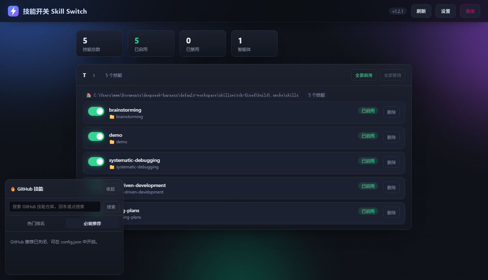

# SkillSwitch

**English** | [中文](README.md)

A Windows desktop app for managing **skills / plugins / MCP servers / subagents / slash commands** across several AI coding agents — see them in one place, toggle them, install new ones from GitHub, and remove them without fear. **Every config change is backed up first and can be rolled back.**



## Why

If you use more than one AI coding agent (DSH, Claude Code, Codex…), you hit the same problems:

- Dozens of installed skills, all English folder names — **you can't tell what's what**
- Too scared to delete an unused one, because **you don't know what else references it**
- MCP servers and plugins live in `config.toml` / `cordis.patch.yml` — **one bad edit and the agent won't start**
- Installing an MCP from GitHub means reading its README, finding the launch command, and hand-writing a config block

SkillSwitch puts all of that behind one UI and makes config edits **undoable**.

## Features

### Skills

- Scans multiple agents × multiple skill roots
- Enable / disable with one click (renames `SKILL.md`, never deletes content)
- Deletes go to the Recycle Bin
- Understands both `<name>/SKILL.md` and flat `<name>.md`

### MCP servers (Codex)

- **Inspect** what's installed in `~/.codex/config.toml`, with a plain-language description
- **Install** from a GitHub repo: reads the README, suggests `npx` / `uvx` / `docker` commands, **you confirm** before anything is written
- **Toggle** with one line (`enabled = true|false`)
- **Remove** exactly one section (including sub-sections like `.env`) — everything else stays byte-identical

### Plugins (Codex)

- Lists declared plugins and marketplaces with descriptions
- Enable / disable / remove declarations
- Declaring a new plugin requires its marketplace to already exist — otherwise it refuses and lists what's available

### Safety

| Mechanism | What it does |
|---|---|
| Backup before every write | Stored in `%APPDATA%\SkillSwitch\backups\`, last 20 kept |
| One-click rollback | Restores a backup; **it backs up the current file first**, so a rollback is itself reversible |
| Append-only / section-scoped edits | Never touches parts of the file you didn't ask it to touch |
| Refuse when unsure | Unknown marketplace, illegal name, duplicate — refused, never guessed |
| Local token | The local HTTP API requires a token (`%APPDATA%\SkillSwitch\token.txt`) and validates the Host header against DNS rebinding |
| Never touches your skills | The app will not delete your skill directories |

## Install

Download `SkillSwitch.exe` from [Releases](https://github.com/) and run it. No installer, no dependencies.

> The binary is currently unsigned, so Windows SmartScreen may warn about an unknown publisher. The full source is in this repository — audit it or build it yourself.

## Build from source

Requires Node.js 22+:

```bash
pnpm install          # or npm install
node build/build.mjs  # produces dist/SkillSwitch.exe
```

Pipeline: bundle `src/server.js` with the inlined UI into a SEA blob → inject with `postject` → embed icon and version info with `resedit` → flip the PE subsystem from CUI to GUI so no console window appears.

For development:

```bash
node src/server.js
```

## Supported agents

| Agent | Skills | MCP | Plugins |
|---|---|---|---|
| DSH | ✅ | not yet | read-only |
| Claude Code | ✅ | read-only | — |
| Codex | — | ✅ full | ✅ full |
| WorkBuddy | ✅ | — | — |

## Roadmap

- [ ] DSH plugin / MCP install (requires a package manager — generate the command, don't run it)
- [ ] "Blast radius" preview before deleting a skill
- [ ] Highlighted diff before writing
- [ ] Code signing

## License

[Apache-2.0](LICENSE)