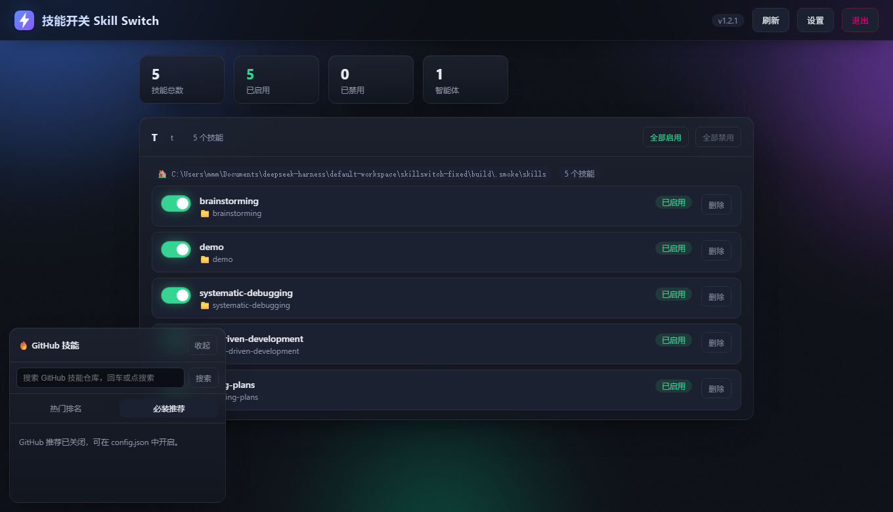

# SkillSwitch

[English](README.en.md) | **中文**

一个 Windows 桌面工具，用来管理多个 AI 编程工具里的 **skill / 插件 / MCP / 子代理 / 斜杠命令**：
在一个界面里看见它们、开关它们、从 GitHub 装新的、不要了就删掉——**每一步都先备份，随时能回滚**。



## 为什么做这个

同时用 DSH、Claude Code、Codex 这些工具的人，都会遇到同一类麻烦：

- 装了几十个 skill，全是英文文件夹名，**不知道哪个是哪个**
- 想删掉一个不用的，但**怕删错**——不知道还有没有别的东西在引用它
- MCP 和插件要改 `config.toml` / `cordis.patch.yml`，**改坏一次整个工具就起不来**
- 想装一个 GitHub 上的 MCP，得自己翻 README 找启动命令，再手写配置段

SkillSwitch 把这些收进一个界面，并且**把「改配置」这件事做得可撤销**。

## 现在能做什么

### 技能（skill）

- 扫描多个智能体 × 多个技能目录，列出全部技能
- 一键启用 / 禁用（改 `SKILL.md` 的文件名，不删内容）
- 删除进回收站，删错了能还原
- 支持 `<名字>/SKILL.md` 和平铺的 `<名字>.md` 两种结构

### MCP（目前支持 Codex）

- **看见**：从 `~/.codex/config.toml` 读出已装的 MCP，显示它是什么、启动命令、配置文件位置
- **安装**：粘贴一个 GitHub 仓库地址 → 从 README 里识别 `npx` / `uvx` / `docker` 启动命令 → **你核对后**再写入
- **开关**：改 `enabled` 一行，不用删了重装
- **移除**：精确删掉 `[mcp_servers.名字]` 整段（含 `.env` 子段），其余内容一个字节不动

### 插件（目前支持 Codex）

- 看见已声明的插件和市场，带中文说明
- 开关 / 移除声明
- 声明新插件时，**市场必须已存在**，否则拒绝并列出可用市场

### 安全设计

| 机制 | 说明 |
|---|---|
| 改前必备份 | 每次写配置前存到 `%APPDATA%\SkillSwitch\backups\`，保留最近 20 份 |
| 一键回滚 | 用备份覆盖回去；**回滚前还会再备一次**，回滚本身也能反悔 |
| 只追加 / 只改目标段 | 不动你没碰过的内容，改完可逐字节比对 |
| 认不出就拒绝 | 插件市场不存在、名字非法、重名——一律拒绝，不猜着写 |
| 本地令牌 | 本地 HTTP 接口需要令牌（`%APPDATA%\SkillSwitch\token.txt`），并校验 Host 防 DNS rebinding |

## 安装

从 [Releases](../../releases) 下载 `SkillSwitch.exe` 双击运行即可，无安装、无依赖。

> 目前没有代码签名，Windows 可能提示「未知发布者」。源码全部在这个仓库里，可以自行审计或构建。

## 从源码构建

需要 Node.js 22+：

```bash
pnpm install          # 或 npm install
node build/build.mjs  # 产物在 dist/SkillSwitch.exe
```

构建流程：把 `src/server.js` 与内嵌的界面打成 SEA blob → `postject` 注入到 node 可执行文件 → `resedit` 写入图标与版本资源 → 把 PE 子系统从 CUI 改成 GUI（双击不弹黑框）。

开发时直接跑：

```bash
node src/server.js
```

## 支持哪些工具

| 工具 | 技能 | MCP | 插件 |
|---|---|---|---|
| DSH | ✅ | 暂不支持 | 只读展示 |
| Claude Code | ✅ | 只读展示 | — |
| Codex | — | ✅ 增删改查 | ✅ 开关/移除/声明 |
| WorkBuddy | ✅ | — | — |

## 路线图

- [ ] DSH 的 MCP / 插件安装（要跑包管理器，只生成命令不代跑）
- [ ] 删除前的「影响面预览」：删这个技能会连累谁
- [ ] 安装前的高亮 diff
- [ ] 代码签名

## 许可证

[Apache-2.0](LICENSE)

---

版本历史见 [docs/CHANGELOG.md](docs/CHANGELOG.md)。